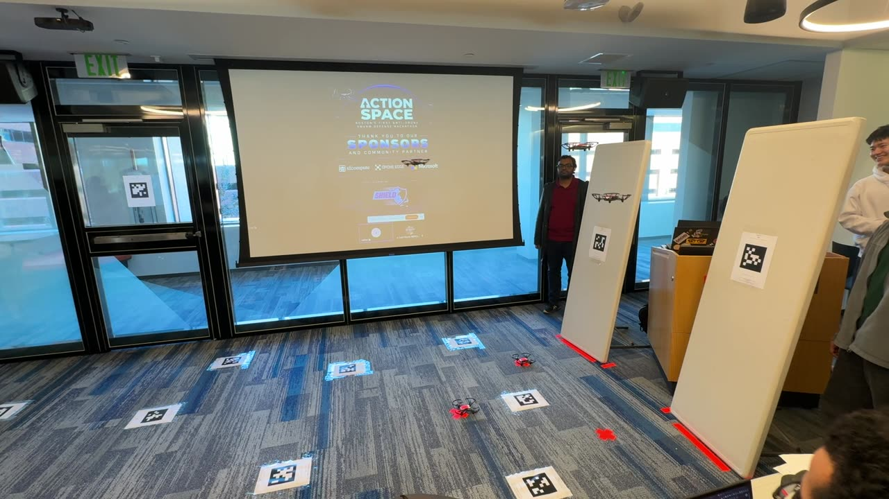
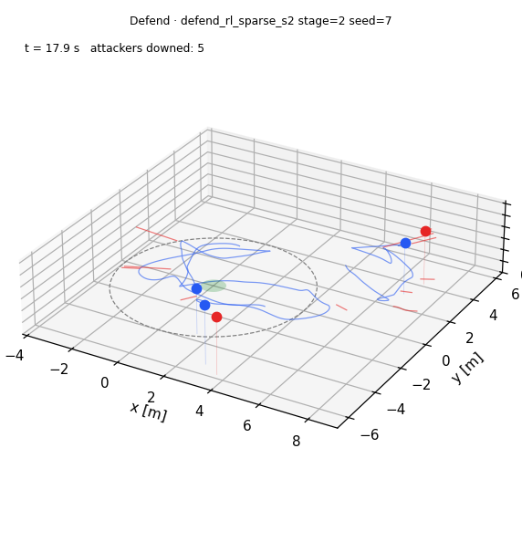
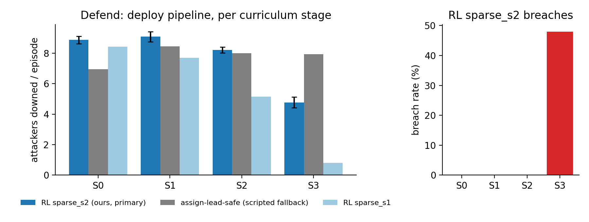

# Action Space Defenders

RL-trained swarm of 3 Tello EDU drones that intercepts and downs attacking drones in a live arena.

🏆 **Winner — Action Space Hackathon (Microsoft NERD, Oct 2026) · only team to take down a drone in the real-flight run**

---

## Demo

[](media/action_space_sim2real.mp4)

▶ [Watch the 36 s video](media/action_space_sim2real.mp4)

*36 s · real-flight run at Microsoft NERD → the same policy in sim*




---

## Pipeline

```
Isaac Lab environments  (AS-Defend-Live-v0, curriculum S0→S6)
        │
        ▼
MAPPO sparse-reward training  (3 defenders, shared-param MLP per agent)
  · 16 384 parallel envs · A30 GPU cluster
  · stages S0–S6: increasing attacker speed, count, noise
        │
        ▼
numpy MLP export  (policy.npz)
  · architecture: 53 → 256 → 128 → 64 → 4, ELU, 3 independent heads (one per defender)
  · RunningStandardScaler obs normalisation baked in
        │
        ▼
deploy: swarm_ops plugin (defend_rl / scripted defend_lead fallback)
  · organizer's AprilTag localisation + attacker telemetry feed
  · safety layer: 0.5 m hard separation, 0.8 m soft, geofence
  · custom height controller (P=0.6, cap 60 rc units → 1 m/s climb)
  · 3 Tello EDU, numpy-only host (no GPU at runtime)
```

---

## Results

| Task | Ours | Baseline |
|------|------|---------|
| T1 Hover | 91.6% time < 20 cm · tail 0.0105 m | PD 96% / zero 13% |
| T2 Waypoint | 50.5% < 20 cm · tail 0.218 m | PD 22.7% / 0.305 m |
| T4 Approach | success 0.992 · collision 0.004 | shipped 0.891 / 0.008 |
| Defend S2 (Isaac gate) | **8.125 downed/ep** | assign-lead-safe 8.066 |
| Defend S2 (deploy pipeline) | **8.20 downed/ep · 0% breach** | assign-lead-safe 8.00 |

Full results and per-run trajectories: `results/`. Report: [`report/report.pdf`](report/report.pdf).

---

## Repo map

```
action-space-defenders/
├── deploy/                  Defender package (install alongside organizer kit)
│   ├── install.sh           Copies plugins + weights into organizer repo
│   ├── drone_deployment_infra/
│   │   ├── defend_live.py   Single-file numpy runtime (dry-run / replay / live)
│   │   └── swarm_ops/policies/
│   │       ├── defend_rl.py    RL policy plugin
│   │       ├── defend_lead.py  Scripted fallback
│   │       ├── attack_feed.py  Attacker telemetry UDP decoder
│   │       └── localize_feed.py
│   ├── policies/            Weights for the deploy slot (adi_sparse_s2, s3, aryan_s7_c3)
│   ├── tools/               analyse_defend_log.py · replay_log.py · test_height_ctrl.py
│   ├── patches/             swarm_policies keepalive patch
│   └── README.md            Full runbook
│
├── policies/                Canonical trained weights
│   ├── defend_rl_sparse_s2/   Primary defender (gate pass S2, flew run 1)
│   ├── defend_rl_sparse_s3_nogate/  S3 no-gate (beats scripted at S3 in deploy pipeline)
│   ├── aryan_defend_rl_sparse_s7_c3/ Alt defender
│   ├── hover_t1/            T1 Hover PPO
│   ├── waypoint_t2/         T2 Waypoint PPO
│   └── approach_r2/         T4 Approach SB3
│
├── training/                Our additions to the Isaac Lab environment
│   ├── simulation_infra/
│   │   ├── source/action_space_kit/…/tello_defend/
│   │   │   ├── assignment.py   Min-max intercept-time assignment
│   │   │   ├── attackers.py    Attacker dynamics (kinematic + curriculum)
│   │   │   ├── fast_dynamics.py  Velocity-model physics for stages 0–3
│   │   │   └── feed.py         Alpha-beta attacker state estimator
│   │   ├── scripts/         check_defend_assign.py · log_step_response.py · render_defend_traj.py
│   │   └── tests/           test_defend_assignment.py
│   ├── ops/                 Training scripts (SLURM sbatch, DSP helpers, Blender viz)
│   └── upstream_mods.patch  Diffs for modified organizer files vs upstream/main cd6536a
│
├── plots/                   Summary figures + 3D trajectory stills
├── results/                 Rollout trajectories (NPZ) + validate JSONs
├── report/                  report.pdf + report.tex + figures/
├── videos/                  Sim renders (sim3d/, blender/, metric3d/)
├── media/
│   └── action_space_sim2real.mp4  Promo video (sim → real)
├── LICENSE                  MIT (our code only; see below)
└── THIRD_PARTY.md           Tello URDF BSD-3-Clause attribution
```

---

## How to run

### Deploy (on the organizer's host)

Requires the organizer's [Action Space kit](https://github.com/jaromero3rd/Action_Space).

```bash
# 1. Install plugins + weights into the organizer repo
bash deploy/install.sh /path/to/organizer/Action_Space

# 2. Frame check (walk drone by hand, no --fly)
cd /path/to/organizer/Action_Space/drone_deployment_infra/swarm_ops
python3 swarm_policies.py --run frame_check:1

# 3. Dry run (no motors)
DEFEND_RL_WEIGHTS=../../team4/policies/adi_sparse_s2/policy.npz \
  python3 swarm_policies.py --run defend_rl:1,2,3

# 4. Live flight (3 defenders vs N attackers, 120 s)
DEFEND_RL_WEIGHTS=../../team4/policies/adi_sparse_s2/policy.npz \
  python3 swarm_policies.py --run defend_rl:1,2,3 --fly --duration 120

# Scripted fallback
python3 swarm_policies.py --run defend_lead:1,2,3 --fly --duration 120
```

Full runbook with frame-check procedure, altitude config, and log analysis: [`deploy/README.md`](deploy/README.md).

### Standalone dry-run (numpy only, no organizer kit needed)

```bash
cd deploy/drone_deployment_infra
python3 defend_live.py --help
python3 defend_live.py --dry-run --feed synthetic --ticks 400 --seed 0
```

### Validate policy weights

```python
import numpy as np
d = np.load("policies/defend_rl_sparse_s2/policy.npz")
print(list(d.keys()))   # ['w0','b0','w1','b1','w2','b2','w3','b3', 'obs_mean','obs_std',...]
print(d['w0'].shape)    # (3, 53, 256) — 3 defender heads
```

### Training (Isaac Lab)

Requires Isaac Sim 5.1 + Isaac Lab 2.3.2 and the organizer kit installed
(`simulation_infra/setup.sh`). See [`training/ops/turing_basic.md`](training/ops/turing_basic.md)
for the full GPU cluster recipe and [`training/upstream_mods.patch`](training/upstream_mods.patch)
for the diffs applied to organizer env files.

---

## Team

- **Aditya Patwardhan** ([@adityapat958](https://github.com/adityapat958)): sim environments, RL training, deploy stack
- **Aryan Shah** ([@Schrodingerrs-cat](https://github.com/Schrodingerrs-cat)): stage-7 defender policy (`policies/aryan_defend_rl_sparse_s7_c3`)
- **Marika** ([@marika340](https://github.com/marika340)): collaborator

---

## Licenses

`deploy/`, `policies/`, `training/simulation_infra/source/…/tello_defend/` (our additions), and
`training/ops/` are MIT-licensed (see [LICENSE](LICENSE)).

The organizer's Action Space kit ([github.com/jaromero3rd/Action_Space](https://github.com/jaromero3rd/Action_Space))
has no published license; it is **not** copied here. The deploy package installs plugins
alongside that kit but does not duplicate its source.

The Tello URDF is BSD-3-Clause (Clyde McQueen / Peter Mullen); see [THIRD_PARTY.md](THIRD_PARTY.md).
